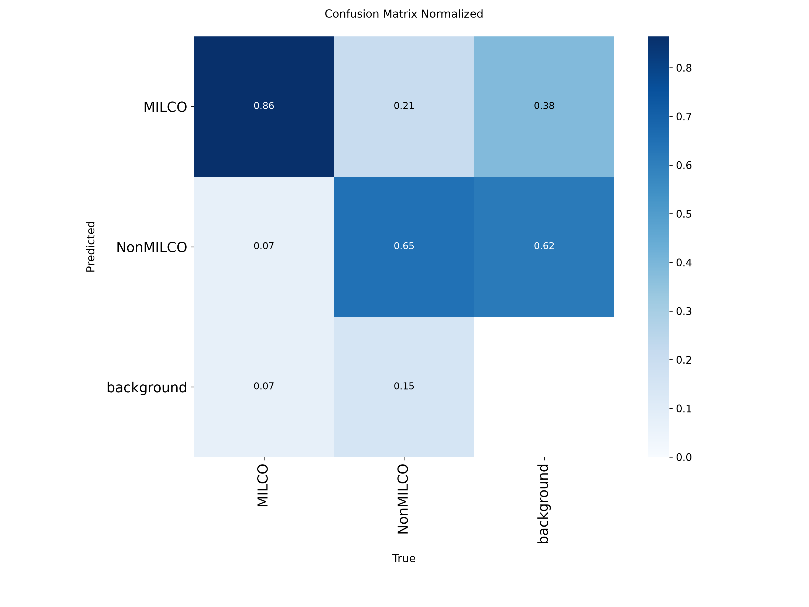
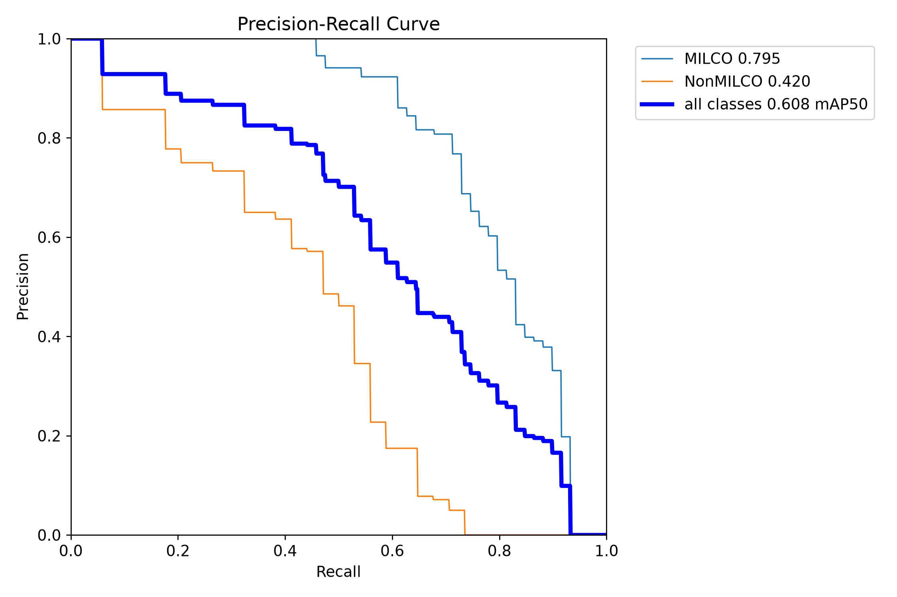
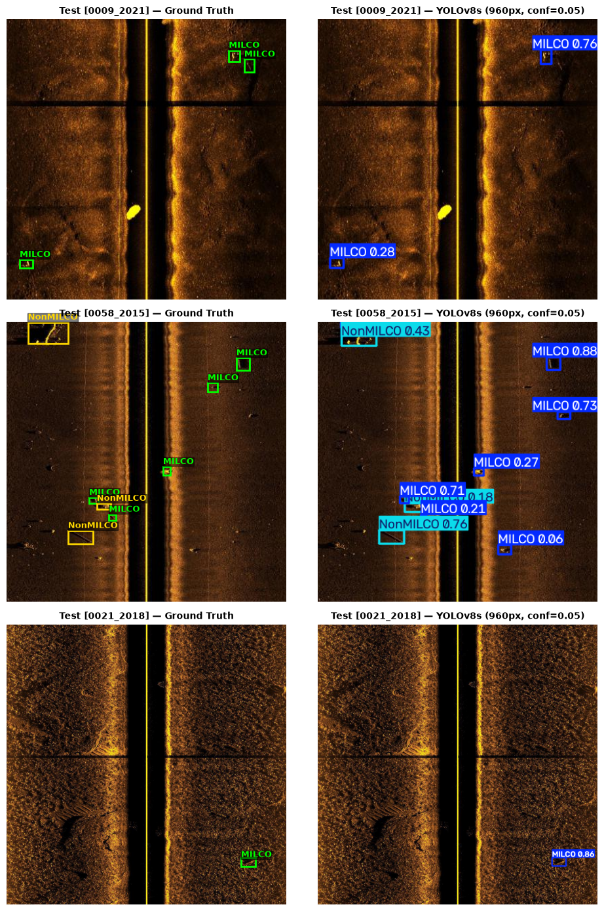

# Mine-Like Target Detection in Side-Scan Sonar Imagery Using YOLOv8

[](https://www.python.org/)
[](https://github.com/ultralytics/ultralytics)
[](https://github.com/AkshatTandekar07/mine-detection-using-YOLOv8-transfer-learning/releases/tag/v1.0.0)

Transfer learning-based object detection pipeline for automatic localization and classification of underwater **Mine-Like Contacts (MILCO)** and **Non-Mine Contacts (NonMILCO)** in side-scan sonar (SSS) imagery using fine-tuned **YOLOv8s**.

---

## 🎯 Target & Key Results

In naval mine countermeasures (MCM), missing a mine (**False Negative**) is catastrophic. The operational target was set to achieve **MILCO recall strictly above 75%** with one-to-one matching at $\text{IoU} \ge 0.50$, while strictly controlling false alarms per image.

### Experimental Comparison (Validation Set)

| Model Pipeline | Input Resolution | MILCO Recall | MILCO Precision | False Alarms / Image | mAP50 | Status |
| :--- | :---: | :---: | :---: | :---: | :---: | :---: |
| **v01 Baseline (Recommended)** | **960 × 960** | **79.66%** (47/59 TP) | **59.49%** | **0.181** | **0.6142** |  **Target Exceeded** |
| **v02 High-Resolution** | 1280 × 1280 | **76.27%** (45/59 TP) | 39.47% | 0.392 | 0.6011 |  Target Met (Higher FP) |

> **Key Finding:** Scaling resolution from 960 to 1280 increased false positives on seabed reverberation and clutter without boosting true mine detections, making the **960px baseline model (`best_960.pt`)** the superior operational choice.

---

## 📊 Evaluation Visualizations

<p align="center">
  
  
</p>

* **Left:** Normalized Confusion Matrix showing high mine detection sensitivity at `conf=0.05`.
* **Right:** Precision-Recall curves across MILCO and NonMILCO classes.

### Qualitative Test Evaluation (Ground Truth vs. Model Prediction)

<p align="center">
  
</p>

* Side-by-side comparison across 3 representative test sonar scenes displaying actual annotations vs. fine-tuned YOLOv8 detections (`conf=0.05`).

---

## 🔬 Dataset & Data Leakage Discovery

* **Classes:**
  * `0: MILCO` (Mine-Like Contact)
  * `1: NonMILCO` (Other seabed clutter / natural debris)
* **Dataset Splits:** 819 training images, 176 validation images, 175 test images.
* **Academic Discovery (Data Leakage):** During exploratory data analysis (EDA), we uncovered that the benchmark dataset contains consecutive survey track frames split across train and validation sets (e.g., `0071_2010` in val vs. `0072_2010` in train). Documented in [reports/v01/audit.md](reports/v01/audit.md) and [reports/v01/related_images.png](reports/v01/related_images.png).

---

## 🚀 Quick Start

### 1. Clone the Repository
```bash
git clone https://github.com/AkshatTandekar07/mine-detection-using-YOLOv8-transfer-learning.git
cd mine-detection-using-YOLOv8-transfer-learning
```

### 2. Setup Environment
Using `uv` (recommended):
```bash
uv sync
```
Or standard `pip`:
```bash
pip install -r pyproject.toml
```

### 3. Run Inference (Automatic Weight Download)
You can test the fine-tuned model directly on any sonar image:

```python
from ultralytics import YOLO

# Load model (or let notebook auto-fetch it from GitHub Releases)
model = YOLO('reports/v01/runs/yolov8s_v01/weights/best.pt')

# Predict on a sonar image
results = model.predict(source='dataset/val/val/images/0001_2021.jpg', conf=0.05, imgsz=960)
results[0].show()
```

---

## 📦 Model Weights & Dataset Releases

Pretrained checkpoints and dataset archives are hosted under [GitHub Releases v1.0.0](https://github.com/AkshatTandekar07/mine-detection-using-YOLOv8-transfer-learning/releases/tag/v1.0.0):

* **[best_960.pt (22 MB)](https://github.com/AkshatTandekar07/mine-detection-using-YOLOv8-transfer-learning/releases/download/v1.0.0/best_960.pt)** — Primary fine-tuned YOLOv8s weights (79.66% MILCO recall).
* **[best_1280.pt (22 MB)](https://github.com/AkshatTandekar07/mine-detection-using-YOLOv8-transfer-learning/releases/download/v1.0.0/best_1280.pt)** — 1280px high-resolution experiment weights.
* **[sonar_dataset.zip (213 MB)](https://github.com/AkshatTandekar07/mine-detection-using-YOLOv8-transfer-learning/releases/download/v1.0.0/sonar_dataset.zip)** — Complete side-scan sonar image dataset.

---

## 📁 Repository Structure

```text
├── dataset/
│   └── mine.yaml                               # Dataset class mapping and schema
├── src/
│   ├── v01.ipynb                               # 960px baseline transfer-learning notebook
│   └── v02.ipynb                               # 1280px resolution experiment notebook
├── reports/
│   ├── Side_Scan_Sonar_Mine_Detection_Report.docx # Comprehensive project report
│   ├── v01/                                    # 960px metrics, curves & results.csv
│   └── v02/                                    # 1280px metrics, curves & results.csv
├── docs/                                       # Project charters, protocols, methodology
├── ppt/                                        # Presentation slides (.pptx)
├── pyproject.toml                              # Dependency definitions
├── uv.lock                                     # Pinned environment lockfile
└── .gitignore                                  # Clean exclusion rules
```

---

## 📜 License & Citation
Academic prototype developed for Side-Scan Sonar Mine Detection research using Ultralytics YOLOv8.
